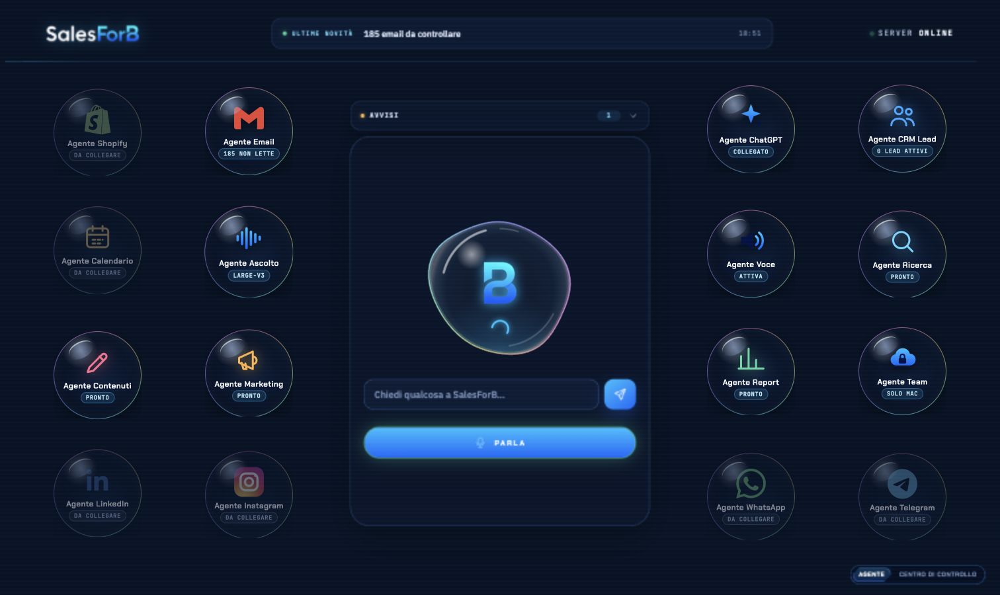

# SalesForB Agents

SalesForB Agents è il centro di controllo desktop di SalesForB: riunisce in un’unica interfaccia gli agenti dedicati a email, CRM, Shopify, calendario, ricerca, contenuti, marketing, report, voce e canali social.



## Funzioni principali

- dashboard desktop responsive con stato degli agenti e KPI;
- conversazione con SalesForB tramite voce o comando scritto;
- trascrizione locale con Whisper;
- sintesi vocale locale;
- collegamento ChatGPT tramite autenticazione OAuth;
- integrazioni predisposte per Shopify, email, CRM, calendario e canali social;
- server locale Python, esposto esclusivamente su `127.0.0.1`.

## Struttura

```text
app/
├── index.html       # dashboard e logica client
├── aqua.css         # design system e layout responsive
├── server.py        # server locale e API
├── brain.py         # orchestrazione e strumenti dell’agente
├── llm.py           # collegamento ChatGPT
├── voice_input.py   # trascrizione vocale
├── wake_input.py    # parola di risveglio
├── tts.py           # sintesi vocale
└── brand/           # loghi e asset grafici
```

## Avvio per lo sviluppo

Questa repository contiene l’interfaccia e il motore applicativo. L’installazione completa richiede il runtime SalesForB/Hermes, i modelli vocali e le skill aziendali, che non sono inclusi nella repository.

Con un runtime già configurato:

```bash
export SALESFORB_HOME="$HOME/.salesforb"
python3 app/server.py
```

La dashboard sarà disponibile su [http://127.0.0.1:8788](http://127.0.0.1:8788).

## Sicurezza

Credenziali, token, database, profili browser, modelli e dati operativi non devono essere versionati. Il file `.gitignore` esclude i percorsi locali più comuni, ma prima di ogni pubblicazione è necessario verificare nuovamente le modifiche.

## Stato del progetto

Versione iniziale in sviluppo attivo. Il pacchetto di installazione distribuibile sarà aggiunto separatamente.
